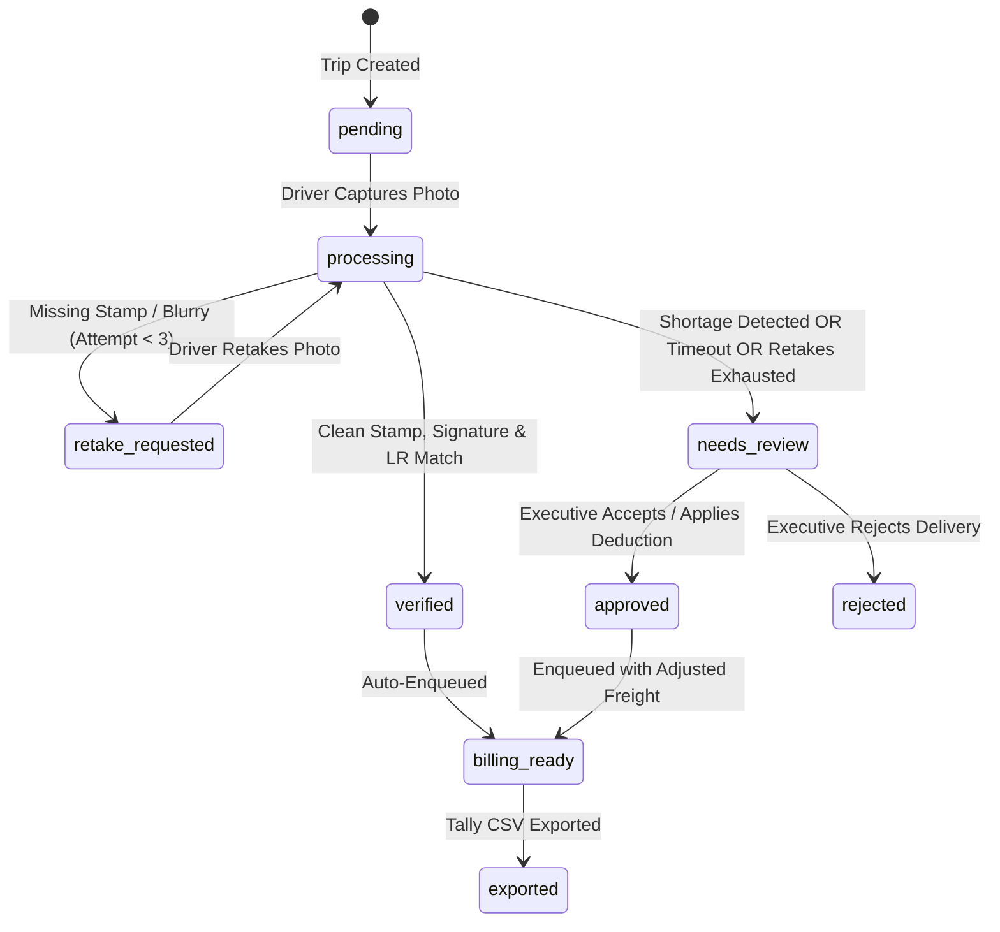

# Technical Design Document (TDD)
## Road Transport Fleet Proof-of-Delivery (POD) Capture and Billing System

**Client:** Company A, Chhatrapati Sambhajinagar, Maharashtra  
**GitHub Repository:** `https://github.com/your-username/road-transport-pod-system` *(Update before submission)*  
**Live Application URL:** `http://localhost:3000` *(Local Turnkey Prototype)*  
**Author:** Candidate (Software Engineering)  
**Submission Requirement:** 1 of 2 in submission ZIP (TDD)

---

## 1. Executive Summary & Business Context

Company A operates a full-truckload transport fleet of 140 company-owned trucks and approximately 200 hired vehicles based in Chhatrapati Sambhajinagar, Maharashtra, transporting cement, steel, and packaged foods. The company completes approximately 2,200 trips per month with an average freight of ₹32,000 per trip (annual freight turnover: ₹84.48 crore).

### The Financial Problem
1. **Working Capital Blockage:** Signed paper Lorry Receipts (LRs) and physical POD documents take 10 to 20 days (average: 18 days) to return from consignees up to 800 km away. Enterprise clients reject invoices without signed PODs attached. Reducing this turnaround from 18 days to 4 days accelerates cash flow by 14 days, releasing **₹3.24 crore** in working capital and saving **₹38.9 lakh** annually in interest (at 12%).
2. **Lost Freight Disputes:** 1.5% of trips (396 trips/year) suffer lost or disputed paper PODs, resulting in freight write-offs of **₹63.36 lakh**.
3. **Total Annual Value Created:** **₹1.02 crore** per year.

This product digitizes the proof-of-delivery workflow, allowing drivers to capture and verify delivery documents at the consignee's gate before departing, while providing the central billing team with real-time operational visibility and automated Tally ledger exports.

---

## 2. Core Build Scope vs Boundaries (What Was Built vs What Was Cut)

In accordance with the brief's instruction to *"build a small part really well instead of the whole scope badly"*, the implementation focuses exclusively on the **CORE BUILD** slice across 6 key screens:

| Subsystem | Included in Core Build | Explicitly Cut (Out of Scope) | Technical Justification |
|---|---|---|---|
| **Driver Experience** | Mobile-first PWA, big capture button, camera fallback, bilingual (Hindi/English), Canvas compression (< 300 KB), IndexedDB offline queue. | Native Android/iOS apps, live GPS breadcrumb tracking. | Transport drivers operate low-end smartphones on intermittent highway cellular networks. Native PWA eliminates app-store install friction. Live tracking is excluded per brief. |
| **Hired Trucks** | Multi-attempt tokenized upload links (`/upload/{token}`) with simulated SMS dispatch modal. | Real paid SMS gateway (Twilio/Gupshup). | Brief explicitly mandates mocking external messages. Scoped token URL simulates exact driver link behavior. |
| **AI Verification** | Gemini Vision multimodal extraction (LR #, invoice/challan #, consignee stamp, signature, quantity, shortage remarks) with 8s timeout and deterministic state machine. | Autonomous automatic invoice dispatch to clients. | AI must never autonomously bill customers. Low confidence, missing stamps, or shortages automatically escalate to human review. |
| **Review & Billing** | Split-screen review workspace with image pan/zoom, non-destructive shortage deduction inputs, duplicate-billing prevention, Tally-compatible CSV export. | Direct bidirectional Tally XML / SOAP API integration. | Tally accounting workflows in Indian logistics rely on batch CSV/XML ledger imports. CSV export provides direct spreadsheet/Tally import without breaking ledger locks. |
| **Operations** | Real-time KPI dashboard (missing vs submitted PODs), daily trip CSV schedule import. | Fuel, toll, driver expense accounting, trip route planning. | Explicitly out of scope in the client brief. Focus is strictly on POD capture and billing acceleration. |

---

## 3. System Architecture & Why We Chose It

```mermaid
flowchart TD
    D[Driver Mobile PWA] -->|Canvas Compress < 300KB| IDB[(IndexedDB Offline Queue)]
    IDB -->|Online Sync / Direct POST| API[FastAPI Backend]
    H[Hired Driver] -->|Tokenized Link /upload/{token}| API
    API -->|Compensation Rollback| ST[(Supabase Private Storage: pod-images)]
    API -->|Advisory Lock & DDL Constraints| DB[(Supabase PostgreSQL 15)]
    API -->|8s Timeout Fail-Safe| AI[Gemini Vision Adapter]
    E[Billing Executive] -->|Next.js Dashboard & Review| API
    API -->|Tally CSV Export| TALLY[Tally Accounting Import]
```

### Architectural Decisions:
1. **FastAPI (Python) Backend:**
   - *Why:* Python is the native ecosystem for multimodal AI SDKs (`google-genai`), CSV manipulation, and high-performance async I/O.
2. **Next.js 14+ App Router (JavaScript/JSX):**
   - *Why:* Provides responsive server-side rendering for the desktop executive dashboard and lightweight client-side Progressive Web App (PWA) performance for mobile drivers.
3. **Supabase (PostgreSQL 15, Auth, Private Storage):**
   - *Why:* Eliminates premature infrastructure bloat (no Kubernetes or separate S3/Redis clusters required for the prototype) while maintaining strict relational constraints, Row Level Security (RLS), and private image storage.
4. **Resilient AI Timeout (8s SLA):**
   - *Why:* Cellular networks at warehouse gates can be sluggish. If Gemini Vision takes longer than 8 seconds, the backend immediately transitions the POD to `needs_review` (`AI_TIMEOUT`) without freezing the mobile UI.

---

## 4. Relational Data Model & State Machines

### 4.1 Database Tables & Constraints (`001_initial_schema.sql`)
- **`profiles`:** 1:1 mapping with `auth.users`, enforcing `role IN ('driver', 'billing_executive')`.
- **`trips`:** Operational freight shipments including `trip_number`, `vehicle_type ('company', 'hired')`, `vendor_name`, `expected_lr_number`, `invoice_number`, and `trip_amount`.
- **`pods`:** Proof of delivery captures with `image_size_bytes <= 307200` (strict 300 KB limit), `client_upload_id` (idempotency key), and `corrected_data JSONB` (recording human adjustments without corrupting raw AI extraction).
  - Status Check: `CHECK (verification_status IN ('pending', 'processing', 'verified', 'approved', 'rejected', 'needs_review', 'retake_requested', 'failed'))`.
- **`pod_verifications`:** Immutable append-only audit trail preserving the photograph storage path and AI extraction JSON for every attempt.
- **`billing_records`:** Verified deliveries ready for Tally export with `CONSTRAINT uq_billing_records_trip UNIQUE (trip_id)` to eliminate the double-billing race condition.
- **`upload_tokens`:** Scoped token hashes for hired drivers with `attempt_count` tracking up to 3 attempts.

### 4.2 State Transition Matrix


---

## 5. UI/UX Design Decisions & Key Screens

The UI was crafted around the two divergent personas identified in the brief:

1. **Driver Experience (Mobile PWA - `/driver` & `/driver/trips/[id]`):**
   - *Low-Literacy & Highway Ergonomics:* Minimal text, large 48px touch targets, icon-led actions, and an English/Hindi toggle.
   - *Zero-Form Philosophy:* Drivers do not type lorry receipt numbers or freight amounts. They tap one big button ("Capture POD / फोटो लें"), preview the image with compressed size indicator, and submit.
   - *Graceful Fallbacks:* If mobile browser camera permissions are blocked, an inline file-picker fallback activates automatically. If GPS is unavailable in a dead zone, the submission completes with null coordinates rather than blocking the driver.
2. **Billing Executive Experience (Desktop - `/dashboard`, `/review`, `/billing`):**
   - *Split-Screen Inspection (`/review`):* Side-by-side high-resolution image viewer with pan/zoom controls on the left, and AI extracted fields with confidence badges on the right.
   - *Financial Shortage Reconciliation:* For damaged/short shipments (e.g. TRP-66141 short by 6 cartons), the executive inputs the quantity adjustment and penalty deduction (₹), automatically recalculating the final billed amount before export.
   - *Simulated SMS Modal (`/dashboard`):* For hired trucks without assigned company drivers, executives click "Simulate SMS" to generate and copy the tokenized upload URL.

---

## 6. Verification Evidence & Quality Assurance

All business logic was verified using automated tests (15/15 passing):
- `tests/test_schema_and_seed.py`: Validated table creation, foreign keys, constraints, and password hashing.
- `backend/tests/test_stage2_core.py`: Validated health endpoints, CORS, and role authentication.
- `backend/tests/test_stage3_trips.py`: Validated driver trip isolation and CSV dispatch import.
- `backend/tests/test_stage4_pods.py`: Validated multipart uploads, 300 KB size enforcement, and hired driver upload tokens.
- `backend/tests/test_stage5_billing.py`: Validated human review approvals, shortage deductions, and Tally CSV formatting.
- `backend/tests/test_e2e_scenarios.py`: Validated the 3 required test scenarios end-to-end.
- Production Next.js compilation: `npm run build` executed with 0 errors across 9 static and dynamic routes.

---

## 7. Assumptions & Next Steps

### Assumptions Made
1. **SMS Gateway:** Simulated via tokenized web URLs and clipboard modal for the prototype.
2. **Tally Format:** Standard CSV ledger format implemented; enterprise clients map columns to specific Tally XML definitions upon live deployment.
3. **AI Vision:** Gemini 1.5 Flash utilized with an 8-second timeout SLA; live API keys are managed in `.env`.

### Next Steps for Full Production Rollout
1. **WhatsApp Business API Integration:** Enable drivers to alternatively send photos via an official WhatsApp bot that feeds directly into the FastAPI ingestion endpoint.
2. **DPDP Act 2023 Masking Pipeline:** Automatic blur filter on non-document background elements (driver face, vehicle license plate) before cloud archiving.
3. **Automated E-Way Bill Portal Sync:** Connect directly with the NIC GST e-way bill API to auto-populate trip master records.
