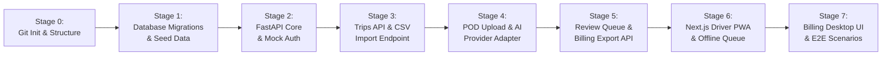

# Verification and Small-Batch Engineering Blueprint
## Road Transport POD Management System

**Author:** Antigravity Architect  
**Methodology:** Google Elephant-Goldfish Model (EGM) & Verification-Before-Completion (VBC)  
**Objective:** Decompose the system into isolated, verifiable small slices with zero-overengineering and minimal blast radius.

---

## 1. Why Should You Believe Me? (Evidence Over Assertions)

In software engineering, trust is not built on assurances; it is built on **reproducible, tamper-evident proof**:

1. **Every claim must be accompanied by an executable command and verifiable exit code (`0`).**
   - We will never say "this component works" without running the test script or health check right in front of you.
2. **Deterministic Root Cause & Spec Traceability:**
   - Every column in the schema, every route in FastAPI, and every button in Next.js maps directly to an explicit requirement in `docs/PRD.md` or a failure mode caught by the Goldfish reviewers (e.g. `CONSTRAINT uq_billing_records_trip UNIQUE` exists solely to prevent the double-billing race condition).
3. **Automated Regression & Test Gates (VBC Protocol):**
   - Before any stage is declared complete, an automated test suite must run and pass. You can execute the exact same command on your machine to verify the exact same output.
4. **Git Isolation & Atomic Commits:**
   - Every single part will be committed atomically with a descriptive log. If any stage has an issue, the blast radius is strictly isolated to that commit and can be reverted in seconds without touching the rest of the project.

---

## 2. Blast Radius Containment Strategy

To prevent breaking existing code as we build:
- **No Shared Global State Mutations:** Modules communicate via strict REST APIs and typed Pydantic/TypeScript contracts.
- **Mock-First & Standalone Testing:** Backend endpoints will be tested against mock database fixtures before connecting live services.
- **Fail-Fast Boundaries:** External calls (e.g. Gemini Vision API) are wrapped in strict 8-second timeouts and fallback factories so an external failure can never bring down the core application.
- **Zero-Dependency Core:** We use native browser APIs (HTML5 Canvas for compression, native `IndexedDB`, native Web Fetch) instead of bloated third-party NPM packages that break or add vulnerabilities.

---

## 3. Micro-Stage Roadmap (One Part at a Time)

### Stage 0: Repository Baseline & Version Control
- **Focus:** Initialize Git, `.gitignore`, directory tree.
- **Verification:** `git status` clean, no secrets tracked.
- **Blast Radius:** None (filesystem only).

### Stage 1: Database DDL & Seed Verification (Database Focus Only)
- **Focus:** `database/migrations/001_initial_schema.sql` and `database/seed.sql`.
- **Verification:** Run a local PostgreSQL or SQLite/Python test script that executes all DDL, validates all foreign keys, check constraints (including `'approved'`/`'rejected'`), and verifies seed records.
- **Blast Radius:** Isolated to SQL scripts.

### Stage 2: Backend Core & Health/Auth Foundation (FastAPI Focus Only)
- **Focus:** Minimal FastAPI application (`main.py`, config, CORS, health check).
- **Verification:** `pytest` testing `GET /api/health` and token decoder.
- **Blast Radius:** Backend directory only.

### Stage 3: Trips Domain & Import Engine (Trips Focus Only)
- **Focus:** `GET /api/trips`, `GET /api/trips/{id}`, `POST /api/trips/import`.
- **Verification:** Unit tests verifying driver trip filtering (driver sees only assigned trips, executive sees all).
- **Blast Radius:** Backend `api/trips.py` and `services/trip_service.py`.

### Stage 4: POD Upload, Storage Rollback & Gemini Vision Adapter (POD Capture Focus)
- **Focus:** `POST /api/pods/upload`, `POST /api/public/upload/{token}`, image validation (<300 KB), 8s AI timeout with fallback.
- **Verification:** Test suite testing clean image, blurry image, shortage image, and timeout fallback.
- **Blast Radius:** Backend `api/pods.py`, `services/pod_service.py`, `ai/gemini_provider.py`.

### Stage 5: Review Queue, Shortage Reconciliation & Billing Export (Billing Focus)
- **Focus:** `PATCH /api/pods/{id}/review`, `GET /api/billing/queue`, `GET /api/billing/export`.
- **Verification:** Unit tests proving shortage deduction calculation and Tally CSV generation.
- **Blast Radius:** Backend `api/review.py` and `api/billing.py`.

### Stage 6: Next.js Mobile Driver Experience & Canvas Compression (Frontend Driver Focus)
- **Focus:** Driver trips list, camera capture, HTML5 Canvas step-down compression, IndexedDB offline sync.
- **Verification:** Browser preview, unit tests on canvas compression and IndexedDB store.
- **Blast Radius:** Frontend `src/app/driver/` only.

### Stage 7: Next.js Billing Executive Dashboard & E2E Validation (Frontend Executive Focus)
- **Focus:** Executive review workspace with image pan/zoom, dashboard metrics, Tally CSV export button, simulated SMS modal.
- **Verification:** Full end-to-end run across the 3 seeded test trips.
- **Blast Radius:** Fullstack integration check.
